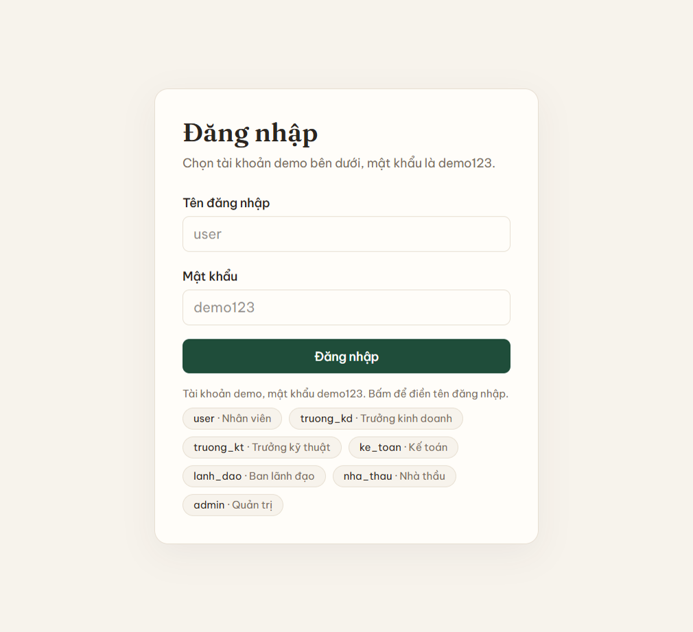
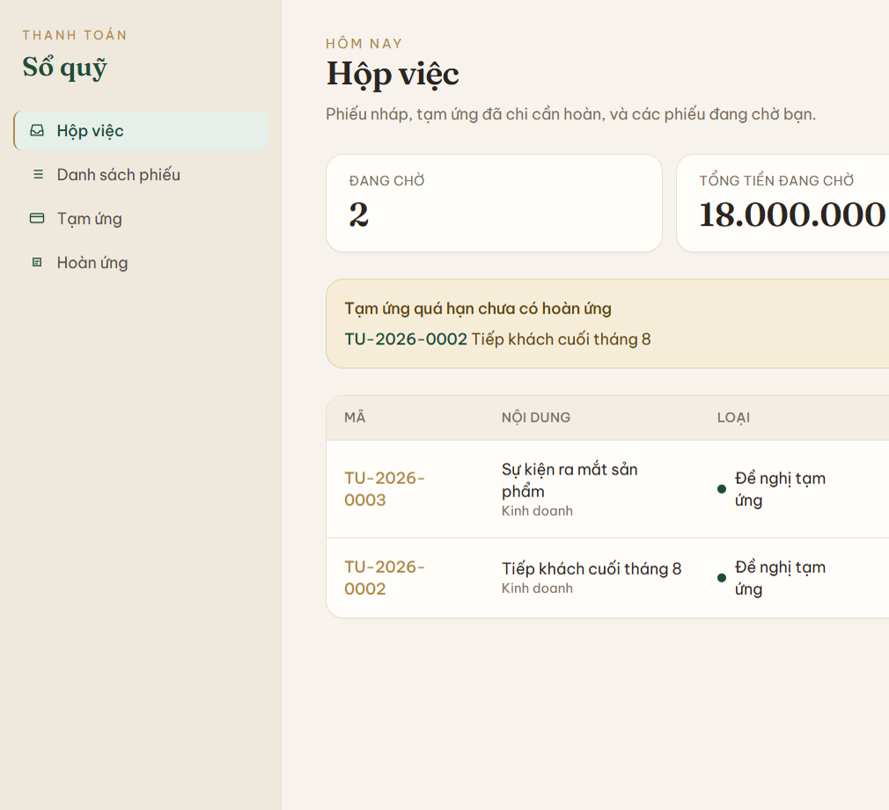
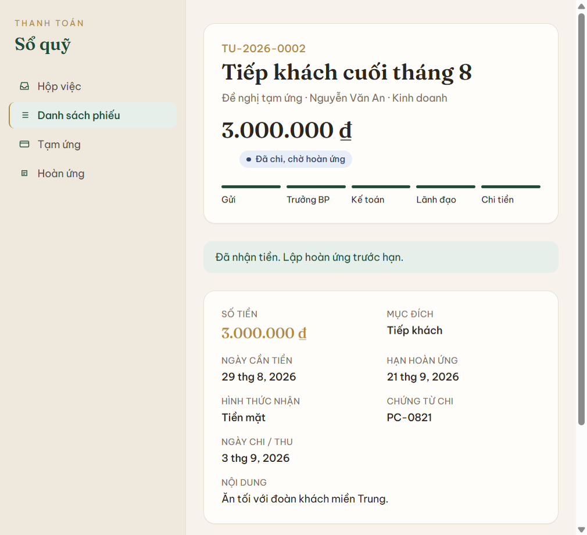
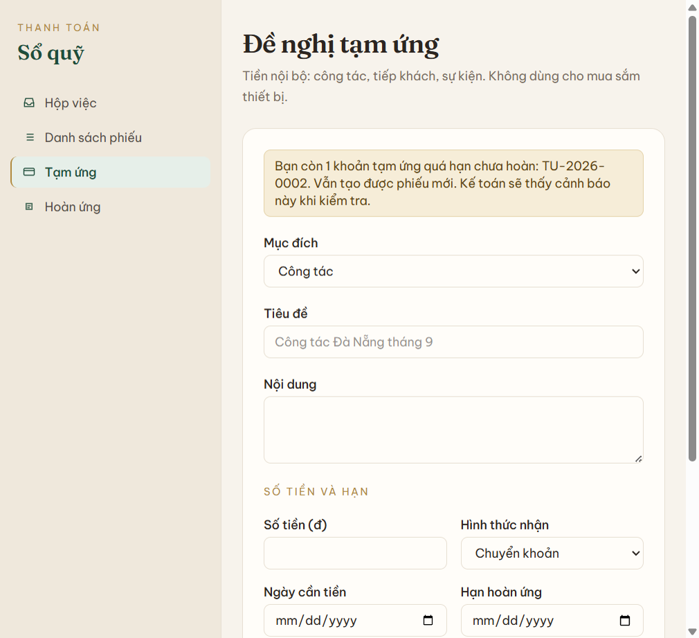
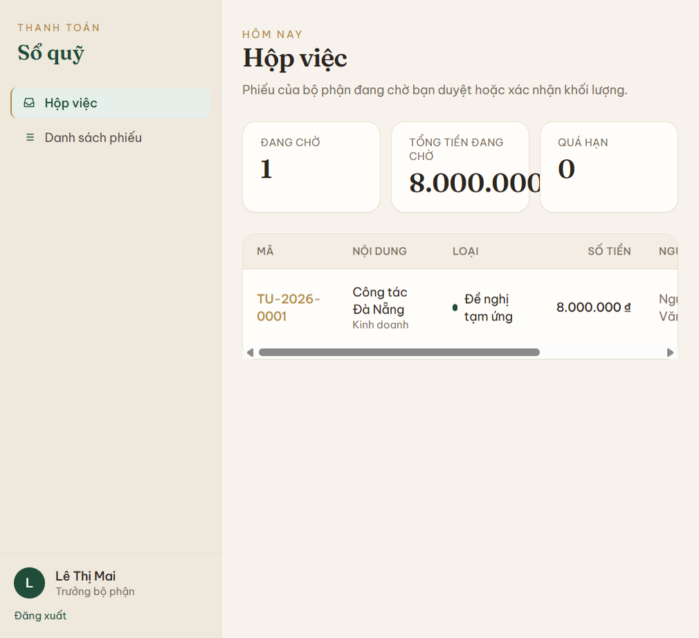
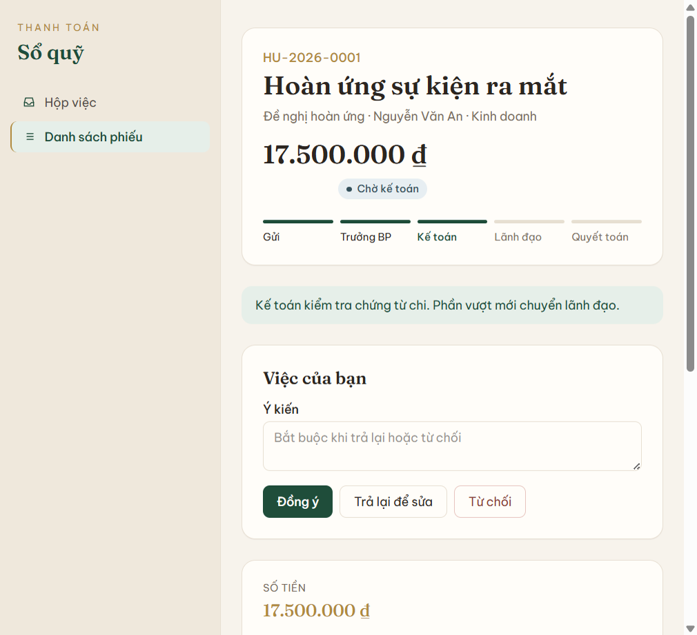
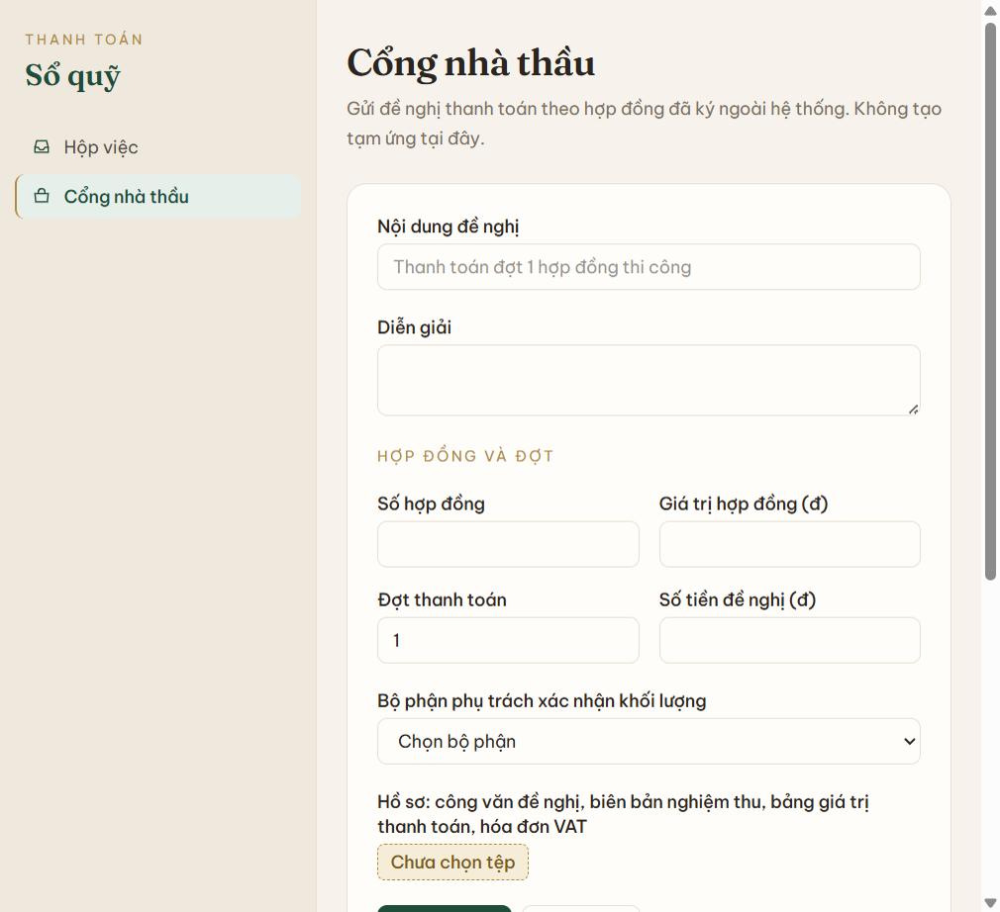

# Hướng dẫn sử dụng

Bản mở trên trình duyệt (có sequence diagram): [USERGUIDE_HeThongThanhToan.html](USERGUIDE_HeThongThanhToan.html).

Hệ thống chỉ có ba loại phiếu tiền. Không dùng cho mua sắm thiết bị hay thi công.

- **Đề nghị tạm ứng** — nhân viên xin tiền công tác, tiếp khách, sự kiện.
- **Đề nghị hoàn ứng** — nhân viên quyết toán một phiếu tạm ứng đã được chi.
- **Đề nghị thanh toán** — nhà thầu gửi theo hợp đồng ký ngoài hệ thống.

Online: https://he-thong-thanh-toan.vercel.app · Local: http://localhost:3000 · Mật khẩu demo: `demo123`.

## Giao diện

Menu trái tên **Sổ quỹ**, nền kem. Mục đang mở có nền xanh nhạt và vạch vàng đồng. Tiêu đề và số tiền dùng chữ serif.

- **Hộp việc** — phiếu đang chờ, ba số: đang chờ, tổng tiền đang chờ, quá hạn.
- **Danh sách phiếu** — mọi phiếu bạn được xem.
- **Tạm ứng** và **Hoàn ứng** — form tạo phiếu nội bộ.
- **Cổng nhà thầu** — form thanh toán theo hợp đồng.
- **Quản trị** — danh sách người dùng.

Thanh tiến trình trên chi tiết phiếu đọc từ trái sang phải. Bước đã qua tô xanh đậm, bước hiện tại tô xanh lá. Hoàn ứng không chi vượt thì bước lãnh đạo bị gạch và ghi “Bỏ qua lãnh đạo”. Badge có chấm màu: tạm ứng xanh lá, hoàn ứng vàng đồng, thanh toán nâu.

## Đăng nhập

Vào `/login`, nhập tài khoản theo vai trò. Hệ thống mở **Hộp việc**. Đăng xuất ở cuối menu trái.

| Tài khoản | Vai trò | Việc chính trên demo |
| --- | --- | --- |
| user | Nhân viên kinh doanh | Gửi tạm ứng, hoàn ứng. Đang có phiếu quá hạn TU-2026-0002 |
| truong_kd | Trưởng Kinh doanh | Duyệt TU-2026-0001 |
| truong_kt | Trưởng Kỹ thuật | Xác nhận khối lượng TT-2026-0002 |
| ke_toan | Kế toán | Kiểm tra HU-2026-0001, chi TU-2026-0005 |
| lanh_dao | Ban lãnh đạo | Duyệt TU-2026-0004 |
| nha_thau | Nhà thầu ABC | Gửi đề nghị thanh toán |
| admin | Quản trị | Xem mọi phiếu, bấm thay vai trò đang chờ |

## Ai thấy phiếu nào

- Nhân viên: chỉ phiếu của mình.
- Trưởng bộ phận: phiếu của bộ phận mình, kể cả đề nghị thanh toán được giao bộ phận đó theo dõi.
- Nhà thầu: chỉ đề nghị thanh toán của mình.
- Kế toán, ban lãnh đạo, quản trị: mọi phiếu.

## 1. Đề nghị tạm ứng

Nhân viên vào **Tạm ứng**, nhập mục đích (công tác / tiếp khách / sự kiện / khác), nội dung, số tiền, ngày cần tiền, hạn hoàn ứng, tiền mặt hoặc chuyển khoản. Chuyển khoản cần số tài khoản. Có thể đính kèm kế hoạch hoặc dự trù.

Luồng:

1. Gửi → chờ trưởng bộ phận.
2. Trưởng bộ phận duyệt → chờ kế toán. Kế toán thấy các khoản tạm ứng khác chưa hoàn và phiếu quá hạn.
3. Kế toán đồng ý → chờ lãnh đạo. Mọi số tiền đều qua lãnh đạo.
4. Lãnh đạo duyệt → chờ chi tiền.
5. Kế toán ghi ngày chi và số chứng từ → **Đã chi, chờ hoàn ứng**.

Từ chối thì phiếu thành **Từ chối**, kèm lý do. Trả lại thì phiếu về **Nháp** để nhân viên sửa và gửi lại.

Được tạo tạm ứng mới khi còn khoản chưa hoàn. Quá hạn chỉ là cảnh báo trên hộp việc của nhân viên và kế toán.

## Thao tác theo vai trò

### Nhân viên

1. Đăng nhập `user`.
2. Bấm **Tạm ứng**. Chọn mục đích, nhập tiêu đề, nội dung, số tiền, ngày cần tiền, hạn hoàn ứng. Chuyển khoản thì nhập số tài khoản. Bấm **Gửi duyệt** hoặc **Lưu nháp**.
3. Bấm **Hoàn ứng**. Chọn phiếu tạm ứng đã chi, thêm từng dòng. Form hiện tổng chi và phần chênh. Bấm **Gửi duyệt**.

### Trưởng bộ phận

1. Đăng nhập `truong_kd` hoặc `truong_kt`. Hộp việc chỉ có phiếu của bộ phận mình.
2. Mở phiếu. Tạm ứng và hoàn ứng: **Đồng ý**, **Trả lại để sửa**, hoặc **Từ chối**. Thanh toán nhà thầu: nút đồng ý là **Xác nhận khối lượng**.
3. Trả lại hoặc từ chối thì phải nhập ý kiến.

### Kế toán

1. Đăng nhập `ke_toan`.
2. Hoàn ứng chi vượt: **Đồng ý** để chuyển lãnh đạo. Chi ít hơn: **Chuyển thu tiền thừa**. Chi bằng: **Quyết toán**.
3. Phiếu chờ chi: nhập ngày và số chứng từ hoặc số ủy nhiệm chi, bấm **Xác nhận**.

### Lãnh đạo

Đăng nhập `lanh_dao`, mở phiếu chờ duyệt, bấm **Đồng ý** hoặc từ chối kèm lý do.

### Nhà thầu

1. Đăng nhập `nha_thau`. Menu chỉ có Hộp việc và Cổng nhà thầu.
2. Nhập nội dung, số hợp đồng, giá trị, đợt, số tiền, bộ phận phụ trách, và file hồ sơ.
3. Bấm **Gửi đề nghị**. Lũy kế vượt giá trị hợp đồng thì không gửi được.

### Quản trị

Đăng nhập `admin`. Thấy mọi menu và mọi phiếu, bấm được nút của vai trò đang chờ.

## 2. Đề nghị hoàn ứng

Nhân viên vào **Hoàn ứng**, chọn một phiếu tạm ứng **đã chi** của mình, kê từng khoản: nội dung, ngày, số tiền, hóa đơn.

- Chi ít hơn số ứng: nhân viên nộp lại tiền thừa, kế toán xác nhận đã thu.
- Chi nhiều hơn: lãnh đạo duyệt phần vượt, rồi kế toán chi thêm.
- Chi bằng số ứng: kế toán xác nhận chứng từ là quyết toán luôn.

Luồng: nhân viên gửi → trưởng bộ phận → kế toán. Chỉ khi chi vượt mới sang lãnh đạo. Xong, phiếu hoàn ứng là **Đã quyết toán** và phiếu tạm ứng gốc thành **Đã hoàn ứng**.

## 3. Đề nghị thanh toán

Nhà thầu vào **Cổng nhà thầu**. Nhập số hợp đồng, giá trị hợp đồng, đợt, số tiền, bộ phận phụ trách, và các file: công văn, biên bản nghiệm thu khối lượng, bảng giá trị thanh toán, hóa đơn VAT.

Một hợp đồng có nhiều đợt. Khi gửi, hệ thống cộng các đợt đang xử lý hoặc đã trả. Vượt giá trị hợp đồng thì không gửi được. Kế toán kiểm lại lũy kế trước khi chuyển lãnh đạo.

Luồng: nhà thầu gửi → trưởng bộ phận phụ trách xác nhận khối lượng → kế toán → lãnh đạo → kế toán chi, ghi số ủy nhiệm chi → **Đã thanh toán**.

Hồ sơ thiếu hoặc sai thì **Trả lại nhà thầu**. Nhà thầu bổ sung và gửi lại.

## Trạng thái

| Trạng thái | Ý nghĩa |
| --- | --- |
| Nháp | Người tạo đang sửa |
| Chờ trưởng bộ phận | Duyệt tạm ứng / hoàn ứng, hoặc xác nhận khối lượng |
| Chờ kế toán | Kiểm tra chứng từ, hạn mức, lũy kế |
| Chờ lãnh đạo duyệt | Duyệt cuối. Hoàn ứng chỉ vào bước này khi chi vượt |
| Chờ chi / thu tiền | Kế toán chi hoặc thu phần chênh |
| Đã chi, chờ hoàn ứng | Tạm ứng đã nhận tiền |
| Đã hoàn ứng | Tạm ứng gốc đã được quyết toán |
| Đã quyết toán | Phiếu hoàn ứng xong |
| Đã thanh toán | Nhà thầu đã nhận tiền |
| Từ chối | Dừng, có lý do |
| Trả lại | Nhà thầu sửa hồ sơ. Phiếu nội bộ trả về thì về Nháp |
